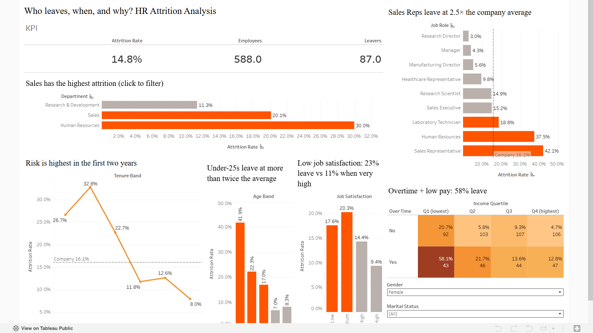
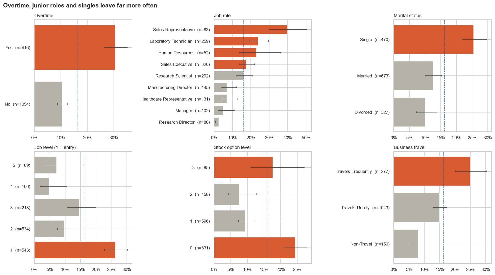
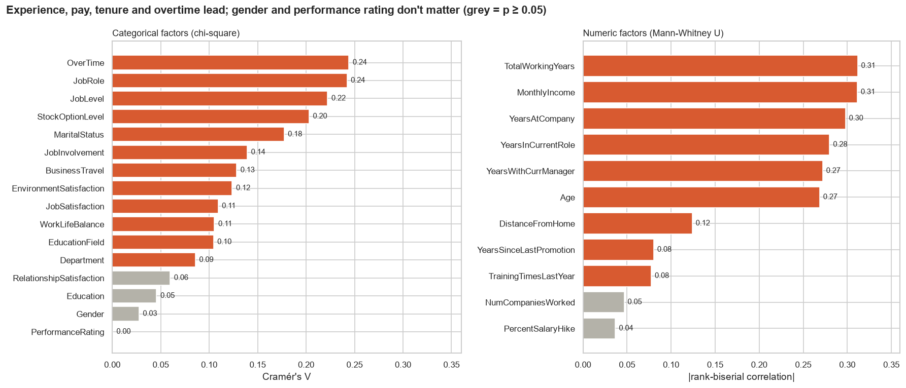
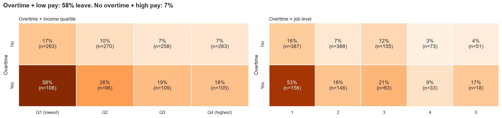
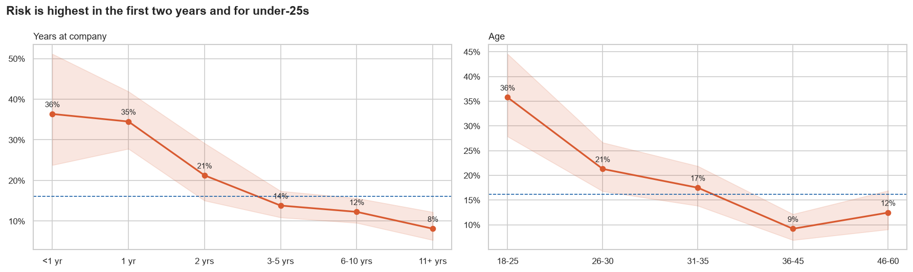

# HR Employee Attrition — Exploratory Data Analysis

Who leaves, when, and why? An exploratory analysis of **1,470 employees (237 leavers)** using statistical tests, confidence intervals and risk-factor combinations, plus an interactive **Tableau Public dashboard**.

🔗 **[Interactive dashboard on Tableau Public](https://public.tableau.com/app/profile/danysh.hykal/viz/HREmployeeAttritionAnalysis_17948431442780/HRAttritionDashboard)**

[](https://public.tableau.com/app/profile/danysh.hykal/viz/HREmployeeAttritionAnalysis_17948431442780/HRAttritionDashboard)

>  **Data note:** this is the IBM HR Analytics Employee Attrition dataset, a **fictional dataset created by IBM data scientists**. Public HR data with employee-level detail (pay, satisfaction, overtime) is almost never released, for privacy reasons. The patterns are realistic, and the methods here apply directly to real HR data.



##  Questions
1. What is the overall attrition rate, and how certain is it?
2. Which employees leave most, and when in their career?
3. Which factors matter most, statistically, and which don't matter at all?
4. Where does risk concentrate when factors combine?

##  Key Insights

**1. Overtime is the strongest single driver, and low pay makes it much worse.**
Employees on overtime leave at **30.5%** vs **10.4%**. Combined with the lowest income quartile, **58% left**, compared with 7% for well-paid staff without overtime.
→ *Recommendation:* monitor sustained overtime and prioritise pay reviews for low-paid staff working it.

**2. The first two years are the danger zone.**
**43% of all leavers** left within their first two years. Attrition is 36% in year one, falling to 8% after 11+ years. Under-25s leave at 36%.
→ *Recommendation:* strengthen onboarding, with structured check-ins at 90 days and 1 year.

**3. Risk is concentrated, so retention can be targeted.**
Single, entry-level employees on overtime: **68% left** (40 of 59). Employees above entry level without overtime leave at well under 10%.
→ *Recommendation:* focus retention budgets on a few high-risk profiles instead of company-wide programmes.

**4. Sales Representatives are the biggest hotspot.**
**39.8%** attrition, 2.5× the company average, vs 2.5% for Research Directors.
→ *Recommendation:* a clear career path from Sales Representative to Sales Executive (17.5% attrition).

**5. Some popular assumptions don't hold.**
Gender (p = 0.29), education (p = 0.55) and performance rating (p = 0.99) show no significant link to leaving.
→ *Recommendation:* don't build retention policy around them. (Performance rating only has two values in this data, so it can't separate weak from strong performers.)

##  Statistical Ranking of Drivers



Each factor was tested: **chi-square + Cramér's V** for categories, **Mann-Whitney U + rank-biserial correlation** for numbers. The p-value shows whether a difference is likely real; the effect size shows whether it's big enough to matter.

##  Where Risk Concentrates



##  When People Leave



##  Skills Demonstrated

| Area | What I did |
|---|---|
| **Data quality** | Checked missing values, duplicates and constant columns; found three undocumented "rate" columns with zero correlation to salary and dropped them as noise |
| **Feature preparation** | Decoded survey codes into labels; created age, tenure and income bands |
| **EDA** | Univariate, bivariate and multivariate analysis; attrition rates with 95% Wilson confidence intervals |
| **Statistics** | Chi-square, Cramér's V, Mann-Whitney U, rank-biserial correlation; separated significance from effect size |
| **Visualisation (Python)** | matplotlib/seaborn: rate charts with error bars and a benchmark line, heatmaps with sample sizes, confidence bands, finding-led titles |
| **Visualisation (Tableau)** | Calculated fields, LOD expression (`FIXED`), reference lines, highlight table, dashboard filter actions, published to Tableau Public |

##  Data Preparation
| Step | Detail |
|---|---|
| Checks | 0 missing values, 0 duplicate rows, 0 duplicate employee IDs |
| Dropped: constant columns | `EmployeeCount`, `Over18`, `StandardHours` (same value for everyone) |
| Dropped: ID | `EmployeeNumber` |
| Dropped: noise | `DailyRate`, `HourlyRate`, `MonthlyRate`: undocumented and uncorrelated with `MonthlyIncome` (r ≈ 0) |
| Decoded | Education, satisfaction, involvement, work-life balance and performance codes → labels |
| Created | `AgeBand`, `TenureBand`, `IncomeQuartile`, `Left` (0/1) |

##  Limitations
- Fictional data: findings illustrate the method, not a real company.
- One snapshot in time, so there are no dates of leaving; tenure is used instead.
- Correlation, not causation: overtime may be a symptom of under-staffing that also drives people away.
- Small groups (e.g. 52 HR staff) have wide confidence intervals; they're shown on every chart so they aren't over-interpreted.

##  Repo Structure
```
├── data/emp_attrition.csv               # source data (IBM, ODbL)
├── notebooks/hr_attrition_eda.ipynb     # full EDA
├── tableau/hr_attrition_tableau.csv     # cleaned export for Tableau
├── images/                              # charts used in this README
├── docs/
│   ├── BUILD_GUIDE.md
│   └── TABLEAU_GUIDE.md
└── requirements.txt
```

##  How to Run
```
pip install -r requirements.txt
jupyter notebook notebooks/hr_attrition_eda.ipynb
```
Then **Run All**. Dashboard steps: [docs/TABLEAU_GUIDE.md](docs/TABLEAU_GUIDE.md).

##  Data Source
IBM HR Analytics Employee Attrition & Performance, a fictional dataset created by IBM data scientists. File from [IBM/employee-attrition-aif360](https://github.com/IBM/employee-attrition-aif360), originally published on [Kaggle](https://www.kaggle.com/datasets/pavansubhasht/ibm-hr-analytics-attrition-dataset). Licensed under the [Open Database License (ODbL)](https://opendatacommons.org/licenses/odbl/1.0/) / [Database Contents License (DbCL)](https://opendatacommons.org/licenses/dbcl/1.0/).

---
**Danysh** · B.CS (Hons.) Data Science, Multimedia University · [LinkedIn](https://www.linkedin.com/in/muhammad-danysh-hykal-9213581b7/) · [GitHub](https://github.com/danyshykal)
